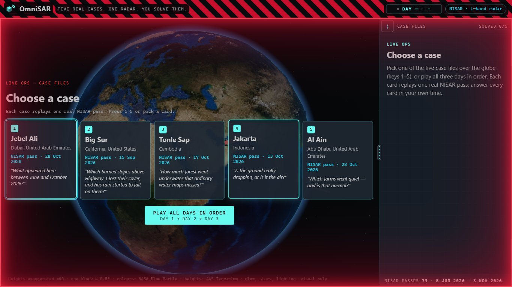
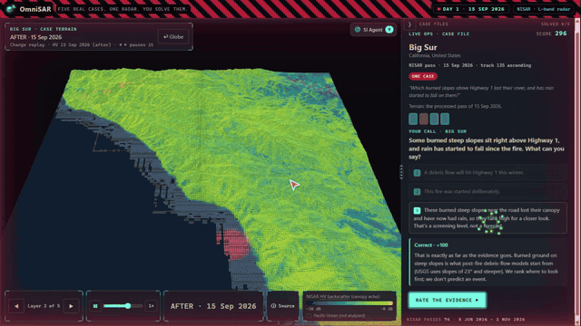

<p></p>

# OmniSAR

**Five real cases. One radar. You solve them.**

**▶ Play it:** https://zaid-aamir.github.io/OmniSAR &nbsp;·&nbsp; **30-second demo:** https://youtu.be/FwgIRJujk00
Free, in any browser, with no login, install or coding.



**Team Iteration Lab:** Zaid, Shaurya, Yuruihang, Rayyan · NASA Space Apps Challenge 2026 · Challenge: *Dancing with the SARs*
· **1st place, Sharjah local event**

| | |
|---|---|
| **138 GB → 32 MB** | 55 real NISAR files processed into a website over 4,000 times smaller |
| **5 real 2026 cases** | Big Sur fires, Jebel Ali building, Tonle Sap floods, Jakarta sinking, Al Ain farms |
| **17 traps** | ways radar data fools you, each one shown with our own NISAR data |
| **Checked answers** | every verdict tested against a second source; 86% of the Big Sur burn map sits inside the official NIFC fire perimeters |



OmniSAR is an interactive web app built for the 2026 NASA Space Apps Challenge **"Dancing with the SARs"**. It uses
radar data from **NISAR**, the NASA-ISRO L-band radar satellite, to track surface change at five places around the world.
You play each place as a mystery: sort real evidence from traps, test the evidence with switches, rebuild the chain of
cause and effect, and reach a verdict. Every verdict comes with a measured number, an independent check, a confidence
badge and a list of what the radar can't prove.

## The five cases

| # | Case | Question | NISAR data |
|---|------|----------|-----------|
| 1 | Jebel Ali, Dubai (UAE) | What appeared here between June and October 2026? | Radar images (GCOV), track 056 ascending |
| 2 | Big Sur, California (USA) | Which burned slopes above Highway 1 lost their cover, and has rain started to fall on them? | GCOV, track 135 ascending |
| 3 | Tonle Sap (Cambodia) | How much forest went underwater that ordinary water maps missed? | GCOV, track 083 ascending |
| 4 | Jakarta (Indonesia) | Is the ground really dropping, or is it the air? | Interferograms (GUNW), track 010 ascending (018 descending tested) |
| 5 | Al Ain (UAE) | Which farms went quiet, and is that normal? | GCOV, track 056 ascending |

The current numbers and badges are in each case's verdict in the app, and in `cases/<case>.numbers.json`.
A case whose measurements don't exist yet says **"Evidence pending"**. The app never shows a made-up number.

## How to play: Live Ops (the default)

Live Ops is a replay of real 2026 NISAR passes on their real dates. (In reality, processed NISAR data reaches users
days after a pass.)

1. **Press PLAY.** The case picker opens over the globe: one card per case, with its place, the date of the NISAR pass
   it replays and its question. Pick a case (click it, Tab + Enter, or press **1–5**), or choose
   **Play all days in order** for the full Day 1 → Day 2 → Day 3 run.
2. **The pass comes in.** The globe flies to the case, red alert ripples spread, and the case terrain opens on the
   latest processed pass on or before that date. No card ever shows data dated after the pass.
3. **Call each evidence card** in your own time (there is no timer): **Real change**, **Trap** or **Wait for next
   pass** (keys 1, 2, 3). A wrong call on a trap explains what fooled you and how OmniSAR handles it; press Continue
   when you're ready.
4. **Make the final call, rate the evidence** (Strong / Moderate / Weak), then see OmniSAR's real verdict from the
   case's numbers. **Choose another case** goes back to the picker, where solved cases show their score and badge.

## How to play: classic case mode (`?mode=classic`)

1. **Globe.** Spin the blocky globe. Each column is a case. Drag the timeline (1 Jun – 10 Nov 2026) to see the real
   NISAR pass dates, NASA's 27 Jul – 10 Aug data gap, and grey **unverified tips** (natural events from NASA EONET that
   nobody has checked with radar).
2. **Fly in.** Pick a case on the globe or in the list, then **Open mystery**. The view drops to that case's blocky
   terrain: one block is one radar measurement (or a few merged), and its height is real ground height.
3. **Your call.** Answer questions about how to read the radar. Wrong answers open a **trap card** (one of 17 real
   data traps) that explains what fooled you and how we proved it with real data.
4. **Sort the evidence.** Drag each exhibit card (or use its buttons) into **Real change** or **Trap**, and name the trap.
5. **Interrogate.** Flip switches (HH ↔ HV, L-band ↔ C-band, raw ↔ filtered, slopes counted ↔ set apart…) to see which
   "changes" survive.
6. **Cause and effect.** Predict the hidden links. Each link is labelled *Measured by…*, *From published sources…*
   (with the citation) or *Not measured here*.
7. **Verdict.** The measured numbers, the independent check, the evidence badge, and **what the radar can't prove**.
   **Chain of custody** lists every NASA file, every step, every threshold and the script fingerprint, with a JSON
   download.
8. **What you learned.** The radar lesson and the traps you met. Finish all five cases for your investigation summary.

Everything works with a keyboard: Tab moves between buttons, Enter/Space presses them, and the arrow keys step through the terrain layers.

## Run it locally

No build step. Any static file server works:

```
py -m http.server 8000        (or: python3 -m http.server 8000)
```

Then open <http://localhost:8000>. Useful links: `?mode=live&case=big-sur` jumps straight into one Live Ops case;
`?mode=live&day=2` makes PLAY start the days at Day 2; `?speed=fast` speeds up the Live Ops animations;
`?mode=classic&case=big-sur&play` opens a classic case straight away;
`?palette=1` to `?palette=9` switch the colour palette; `?at=lat,lon,distance` sets the starting view.

The app loads only files from this repository at run time: no accounts, no keys, no tracking. Links to sources open
the outside websites only when you click them.

## How the numbers are made (processing scripts)

The raw NISAR files are 2–6 GB each and are **not** in this repository. The scripts in `tools/` read only each case's
box from the finished files and write small results into `cases/` and `assets/`. Each script writes its **method
(every threshold and the badge rule) into the numbers file**. The method was written down before the first result,
and never changed to make a result look better.

| Script | What it does |
|--------|--------------|
| `tools/nisar_io.py` | Shared helpers: read only the case box from a NISAR HDF5 file, UTM ↔ lat/lon, speckle filter, clustering |
| `tools/process_jebel_ali.py`, `tools/evidence_jebel_ali.py` | Jebel Ali change map, interference check, hotspots, photo-check kit, evidence images |
| `tools/process_big_sur.py` | Big Sur burn map (HV drop), radar-geometry flags, NIFC perimeter check, Highway 1 ranking, NASA POWER rain |
| `tools/process_tonle_sap.py` | Tonle Sap open water and flooded forest, check against NASA OPERA DSWx-S1 |
| `tools/process_jakarta.py` | Jakarta ground motion from interferograms: air corrections, coherence mask, 8-pair chain, two-direction check |
| `tools/process_al_ain.py` | Al Ain farm circles from HV vs a desert control, 26-year MODIS greenness history |
| `tools/fetch_pass_dates.py` | Real NISAR pass dates from NASA's CMR catalogue |
| `tools/fetch_eonet.py` | Snapshot of NASA EONET natural events (the unverified tips) |
| `tools/build_globe_assets.py`, `tools/terrain.py` | Globe colours and heights; terrain heights for each case |
| `tools/update_results.py` | Lists which cases have a numbers file (the app's "Measured" status is never typed by hand) |
| `tools/inspect_gcov.py`, `tools/inspect_gunw.py` | Print the structure of a NISAR file and a quick preview |

Needs Python 3 with `numpy`, `h5py` and `Pillow`. NISAR files are downloaded separately from NASA's ASF DAAC (free
NASA Earthdata login).

## Data sources

**NASA and NASA-partner data**
- NISAR L2 GCOV (radar images) and L2 GUNW (interferograms), provisional products: NASA-ISRO, via the Alaska Satellite
  Facility DAAC. <https://search.asf.alaska.edu/>, mission page <https://nisar.jpl.nasa.gov/>
- NASA CMR file catalogue (pass dates): <https://cmr.earthdata.nasa.gov/search/>
- NASA GIBS (Blue Marble globe colours; HLS photos; OPERA pictures): <https://nasa-gibs.github.io/gibs-api-docs/>
- NASA HLS (Harmonized Landsat and Sentinel-2) photos: <https://www.earthdata.nasa.gov/data/projects/hls>
- NASA OPERA RTC-S1 and DSWx-S1 (Sentinel-1 products, via GIBS): <https://www.earthdata.nasa.gov/data/projects/opera>
- NASA POWER daily rain and soil wetness (MERRA-2 based): <https://power.larc.nasa.gov/>
- NASA EONET natural events: <https://eonet.gsfc.nasa.gov/>
- MODIS MOD13Q1 NDVI via the NASA ORNL DAAC MODIS web service: <https://modis.ornl.gov/data/modis_webservice.html>

**Other data**
- AWS Terrain Tiles (Terrarium elevation; SRTM-based in our areas): <https://registry.opendata.aws/terrain-tiles/>
- OpenStreetMap (Highway 1 line, via the Overpass API), © OpenStreetMap contributors, ODbL:
  <https://www.openstreetmap.org/copyright>
- NIFC WFIGS interagency fire perimeters (Timber and Plaskett fires): <https://data-nifc.opendata.arcgis.com/>

## Citations (the "From published sources" links)
- Abidin, H.Z. et al. (2011). Land subsidence of Jakarta (Indonesia) and its relation with urban development. *Natural
  Hazards* 59, 1753–1771. <https://doi.org/10.1007/s11069-011-9866-9>
- Chua, S.D.X. et al. (2022). Drastic decline of flood pulse in the Cambodian floodplains (Mekong River and Tonle Sap
  system). *Hydrology and Earth System Sciences* 26, 609–625. <https://doi.org/10.5194/hess-26-609-2022>
- Staley, D.M. et al. (2016). Updated logistic regression equations for the calculation of post-fire debris-flow
  likelihood in the western United States. USGS Open-File Report 2016-1106. <https://pubs.usgs.gov/publication/ofr20161106>
- Staley, D.M. et al. (2017). Prediction of spatially explicit rainfall intensity–duration thresholds for post-fire
  debris-flow generation in the western United States. *Geomorphology* 278, 149–162. <https://pubs.usgs.gov/publication/70188478>
- USGS Landslide Hazards Program, "Scientific Background" (post-fire debris-flow likelihood model):
  <https://www.usgs.gov/programs/landslide-hazards/science/scientific-background>
- NASA Sea Level Change (Feb 2025). Rate of sea level rise doubled over 30 years, new study shows.
  <https://sealevel.nasa.gov/news/280/rate-of-sea-level-rise-doubled-over-30-years-new-study-shows/>
- Tanase, M.A. et al. (2010). Sensitivity of X-, C-, and L-band SAR backscatter to burn severity in Mediterranean pine
  forests. *IEEE Transactions on Geoscience and Remote Sensing* 48(10), 3663–3675. <https://doi.org/10.1109/TGRS.2010.2049653> (background for the Big Sur HV rule)
- The Jebel Ali development node cites *The National* (12 Jan 2026) and *WAM* (Apr 2026); links are in the app.

## Limits: what the radar can't prove

- **Who or why.** Radar measures how the ground scatters microwaves (and, with interferograms, how it moves). It
  can't see who owns a place, who did something, why, or whether it was allowed. OmniSAR never accuses anyone.
- **The future.** Every number describes the past. There are no forecasts or alerts. Big Sur's "screening level" says
  where to look first, not what will happen.
- **Provisional data.** NISAR products used here are provisional (2026). Jakarta's numbers come from 108 days, which
  is not a yearly rate.
- **Coarse helpers.** NASA POWER rain and wetness are regional (about 50 km squares), not per slope. MODIS greenness is
  250 m. Terrarium heights are a surface model, so buildings can add height.
- **Checks still pending** are shown as pending, for example the Jebel Ali photo check and the Al Ain HLS check.

## Licences and attributions

- OmniSAR code: MIT licence (`LICENSE`), © 2026 Team Iteration Lab. Written for the NASA Space Apps Challenge 2026.
- three.js r170 and OrbitControls, MIT licence (`lib/three/LICENSE`), © three.js authors.
- Globe colours: NASA GIBS Blue Marble (Shaded Relief and Bathymetry). Heights: AWS Terrain Tiles (Terrarium).
- Highway 1: © OpenStreetMap contributors (ODbL). Fire perimeters: NIFC. Rain: NASA POWER. Water map and C-band pictures:
  NASA OPERA (contains modified Copernicus Sentinel-1 data). Natural events: NASA EONET. Pass dates and files: NASA CMR /
  ASF DAAC. Greenness history: NASA ORNL DAAC (MODIS).
- No NASA logos are used. NASA data are used under NASA's open data policy; this project is not endorsed by NASA.

## Use of AI

AI coding assistants (Claude) helped write the code and processing scripts. The game design, case choices, data
testing, the 17 traps and every result check were done by the team. No AI-generated images, audio or data are used.

Every reply to a choice in OmniSAR is pre-written, and every number comes from the processing scripts above.

**SI Agent and Grok.** Each case terrain has an "SI Agent" dropdown that sums up the case and answers questions.
- Its suggested questions, and typed questions by default, use **pre-written answers** (`cases/<id>.si.json`), written
  only from that case's own files and labelled "OmniSAR answer". A typed question is matched to the nearest one by keywords.
- **Optional Grok layer (xAI).** If `js/si-config.js` holds a proxy address, a typed question is sent with the open case's
  data (numbers, evidence-card captions, trap cards, glossary terms) to our own proxy, a Cloudflare Worker kept outside
  this repo, which asks xAI's Grok to answer only from that data. Those replies are labelled "AI answer (Grok): can be
  wrong. The numbers come from OmniSAR's measured data." If the proxy fails, times out (8 s) or hits its rate limit,
  the pre-written answer is shown instead. In this version the proxy address is empty, so the Grok layer is off.
- The site never holds an API key: the key exists only as a secret inside the Worker.
